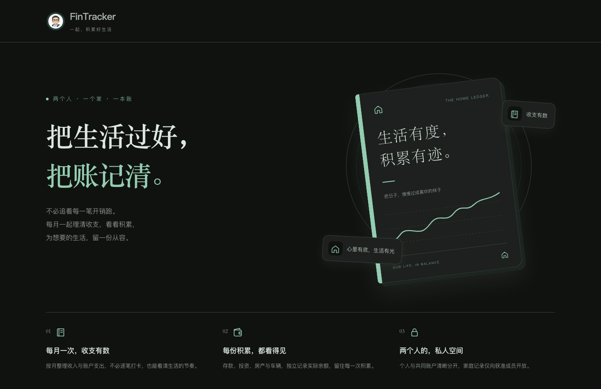

# FinTracker

把生活过好，把账记清。

  <a href="https://muyangamigo.github.io/FinTracker/">
    
     
  </a>

## ✨ About

FinTracker is a private household finance app with a bilingual Chinese/English
interface, built for two people sharing one home.

Rather than chasing every daily transaction, it focuses on a calmer monthly
rhythm: recording monthly income and account spending, tracking independent
asset valuations, and reviewing shared annual reports. There are no bank
connections, AI, or budget features.

## 📒 The ledger

<table>
  <tr>
    <td width="50%">
      <strong>Monthly rhythm</strong> 
      Record income and account spending once a month, keeping blank entries distinct from an explicit zero.
    </td>
    <td width="50%">
      <strong>Independent assets</strong> 
      Track savings, investments, property, and vehicles with point-in-time valuations separate from monthly cash flow.
    </td>
  </tr>
  <tr>
    <td width="50%">
      <strong>Shared, never doubled</strong> 
      Separate personal and shared accounts clearly so joint spending counts once across household reports.
    </td>
    <td width="50%">
      <strong>History preserved</strong> 
      Archiving retains past balances, reports keep each valuation's original date, and version checks guard against stale edits.
    </td>
  </tr>
</table>

## 🔒 A private space

The public landing page shows no financial controls or records. Access requires
an authorized Microsoft account validated against a private server-side
allowlist.

Financial records live in PostgreSQL, never in this public repository or in
GitHub Pages files. Exports stay authenticated, and no finance data is cached in
browser storage.

## 🧭 Behind the app

The site is designed and built as a quiet, focused workspace with:

- Annual overview of income, spending, savings rate, and asset distribution
- Monthly accounting with status-board and comparison-table views
- Asset valuation history and account management
- Bilingual Chinese/English interface and light/dark themes following system preference, with bottom controls to switch language and theme
- Layouts for desktop, tablet, and mobile with keyboard navigation
- Shared in-memory authenticated session with conflict protection

It is built with Next.js and hosted on GitHub Pages, backed by a TypeScript API
and PostgreSQL with Prisma.

---

Life in balance. Progress in view. | 生活有度，积累有迹。

